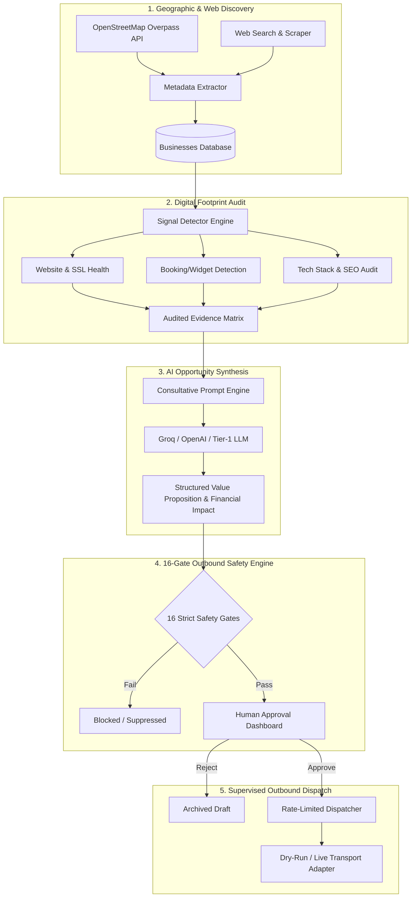

<div align="center">

# 🌐 AI-CLIENT-FINDER
### Autonomous B2B Opportunity Discovery & Consultative Sales Intelligence Engine

[](https://github.com/zaidan-contractor/AI-CLIENT-FINDER)
[](https://www.python.org/)
[](https://fastapi.tiangolo.com/)
[](https://www.postgresql.org/)
[](https://redis.io/)
[](https://www.docker.com/)
[-success.svg?style=for-the-badge&logo=pytest)](https://docs.pytest.org/)
[](LICENSE)

<p align="center">
  <b>A safety-first, multi-tenant intelligence platform that discovers businesses, diagnoses digital/operational gaps, synthesizes consultative opportunity pitches, and enforces strict human-in-the-loop authorization gates before any outbound action.</b>
</p>

[Key Features](#-what-it-can-do-today) •
[Honest Appraisal & Limitations](#-honest-appraisal--what-needs-work) •
[Architecture](#-system-architecture) •
[Quickstart](#-quickstart--local-development) •
[Safety Engine](#-16-gate-outbound-safety--governance) •
[Roadmap](#-development-roadmap)

---

</div>

> [!WARNING]
> ### ⚠️ PROJECT STATUS: UNDER ACTIVE DEVELOPMENT / EXPERIMENTAL
> **AI-CLIENT-FINDER** is currently in **active development and validation phase**. While core architectural primitives (discovery pipelines, evidence analysis, multi-tenant RBAC, and the 16-gate outbound authorization engine) are operational with **346 passing regression tests**, external live connectors (live email dispatch, carrier messaging) default to offline/simulated execution until domain and compliance verification are completed.
> 
> **This is NOT a mass-outreach spam tool.** It is engineered strictly around consultative, evidence-backed B2B intelligence with non-negotiable safety guardrails and human approval requirements.

---

## 📌 Executive Summary

Traditional outbound sales software relies on high-volume, generic cold blasting that destroys sender reputation and yields negligible conversion rates. 

**AI-CLIENT-FINDER** takes the opposite approach: **Evidence-First Consultative Intelligence**.
1. **Targeted Regional Discovery**: Extracts local commercial entities via geographic coordinates and OpenStreetMap Overpass queries.
2. **Signal Detection & Digital Auditing**: Automatically inspects targets for concrete business pain points (missing web presence, lack of mobile optimization, absent booking/reservation widgets, broken assets, and SEO gaps).
3. **AI Opportunity Synthesis**: Converts raw telemetry into structured, business-specific proposals detailing estimated revenue loss, modernization plans, and bespoke consultative value propositions.
4. **16-Gate Safety Engine**: Evaluates every generated campaign against 16 automated guardrails (suppression lists, domain reputation, rate limits, unsubscribe tokens, and mandatory human sign-off) before any message can reach a queue.

---

## 🔍 System Architecture



---

## ⚡ What It Can Do Today (The Honest Truth)

Here is a verified summary of capabilities currently working in the codebase:

### 1. Autonomous Regional Discovery
- **Geographic Harvesting**: Queries OpenStreetMap Overpass infrastructure by city bounding boxes or latitude/longitude radiuses (e.g., sports complexes, dental clinics, hospitality, logistics).
- **Target Extraction**: Normalizes phone numbers, street addresses, coordinates, and declared website URLs into clean tenant records.

### 2. Evidence-Backed Signal Detection
- **Online Footprint Verification**: Validates whether a business has a live, resolving website or is completely reliant on third-party directories.
- **Booking & Service Capability Audit**: Inspects target DOM trees for reservation widgets (Calendly, OpenTable, custom booking systems) to detect missed automation revenue.
- **Technical Gap Diagnostics**: Flags missing SSL certificates, absent mobile meta tags, and incomplete metadata.

### 3. LLM Opportunity Modeling
- **Structured JSON Strategy Synthesis**: Uses Tier-1 LLMs (Groq Llama-3 / OpenAI GPT-4o / Fallback Mocks) to generate personalized value propositions.
- **Financial Impact Estimates**: Produces consultative projections (e.g., estimated revenue lost from absent weekend booking channels) backed by verified signals.

### 4. 16-Gate Outbound Safety Engine
- Hardcoded, non-bypassable guardrails enforcing compliance:
  - **Gate 1-3**: Email format, domain MX resolution, and SPF/DKIM verification.
  - **Gate 4-6**: Privacy-preserving HMAC suppression hashes and global kill-switch check.
  - **Gate 7-10**: Sending hour windows, tenant daily quota enforcement, and per-domain throttling.
  - **Gate 11-13**: Cryptographic RFC 8058 one-click unsubscribe headers.
  - **Gate 14-16**: **Mandatory Human-in-the-Loop review** — automated background jobs CANNOT dispatch campaigns without an explicit administrator signature.

### 5. Multi-Tenant Enterprise Security
- **Strict Tenant & Workspace Isolation**: Complete data segregation between organizations (`org_id`) and workspaces (`workspace_id`).
- **Role-Based Access Control (RBAC)**: Enforces `SuperAdmin`, `WorkspaceAdmin`, `Member`, and `Auditor` scopes.
- **Credential Protection**: Uses AES-256-GCM envelope encryption for API tokens and bcrypt hashing for credentials.

### 6. Local Developer UX (Windows & Cross-Platform)
- **1-Click Windows Launcher** (`start_dev.bat` / `start_dev.ps1`):
  - Automatically verifies Docker Desktop availability.
  - Starts and awaits PostgreSQL (5432) and Redis (6379) health checks.
  - Performs schema validation and preflight checks.
  - Launches FastAPI backend (`:8000`) and Static Frontend (`:5500`) in dedicated consoles.
- **Clean Shutdown** (`stop_dev.bat` / `stop_dev.ps1`): Gracefully kills dev processes while keeping data containers safe.
- **Seeding Tool** (`seed_demo.bat` / `seed_demo.ps1`): Idempotently seeds demo users and test opportunities.

---

## 🛠️ Honest Appraisal: What Needs Work

We believe in full transparency. The following areas are undergoing active refactoring or require further engineering before production readiness:

| Domain | Current State | What Still Needs Work |
| :--- | :--- | :--- |
| **Ground-Truth Heuristics** | OSM Overpass tags sometimes lack website metadata for active businesses. | **Needs multi-source cross-referencing** (e.g., secondary Google Maps Places or Instagram profile lookup) to prevent false positives when OSM data is sparse. |
| **Live Outbound Connectors** | Outbound execution currently runs in **simulation/dry-run mode** by default. | Live SMTP and transactional API connectors (Resend / Postmark / SendGrid) need production webhook handling and bounce loop feedback integration. |
| **Frontend Framework** | Static HTML5 / CSS3 / ES6 vanilla mission control panel. | Functional and responsive, but planned for migration to **React / Vite or Next.js** for modern state management and typed API contracts. |
| **Distributed Crawling** | Scraping operates on single-node background tasks. | Needs distributed Celery/ARQ workers with proxy rotation, politeness delays, and distributed rate limiting for large geographic crawls. |
| **Autonomous Agent Loop** | Prompt pipeline synthesizes opportunities in a single pass. | Needs multi-turn agentic reflection, iterative verification, and persistence of human review corrections. |
| **Cloud Deployment** | Tested on Windows 11 with Docker Compose and WSL2. | Production Kubernetes manifests, Helm charts, and Terraform templates for AWS/GCP are not yet authored. |

---

## 📁 Repository Structure

```
AI-CLIENT-FINDER/
├── backend/
│   ├── alembic/                # Database migrations (PostgreSQL)
│   ├── app/
│   │   ├── api/                # FastAPI routers (auth, businesses, campaigns, safety)
│   │   ├── core/               # Configuration, security, database engine, AES encryption
│   │   ├── models/             # SQLAlchemy ORM models (tenancy, users, signals, audits)
│   │   ├── schemas/            # Pydantic v2 validation models
│   │   ├── services/           # Discovery, signal detection, LLM synthesis, safety gates
│   │   └── workers/            # Background tasks and dispatch queues
│   ├── scripts/                # Seeding, auditing, and live socket verification scripts
│   └── tests/                  # 346 automated pytest suites (100% passing)
├── frontend/
│   ├── index.html              # Mission Control dashboard interface
│   ├── index.css               # Premium dark-mode glassmorphic design system
│   └── app.js                  # Frontend client state, auth handling, and API connector
├── scripts/
│   └── dev_preflight.py        # Automated container & database readiness check
├── docker-compose.yml          # PostgreSQL 16 & Redis 7.2 services
├── start_dev.bat / .ps1        # 1-Click development launcher for Windows
├── stop_dev.bat / .ps1         # Clean developer shutdown scripts
├── seed_demo.bat / .ps1        # Demo data provisioning utility
├── PRODUCTION_SETUP.md         # Detailed production deployment guidelines
└── .env.example                # Safe environment template (no credentials)
```

---

## 🚀 Quickstart & Local Development

### Prerequisites
- **Python**: 3.11, 3.12, or 3.13
- **Docker Desktop**: Running on your machine (for PostgreSQL and Redis)
- **Git**

### Method 1: 1-Click Windows Startup (Recommended)

1. **Clone the repository**:
   ```cmd
   git clone https://github.com/zaidan-contractor/AI-CLIENT-FINDER.git
   cd AI-CLIENT-FINDER
   ```

2. **Configure environment**:
   ```cmd
   copy .env.example .env
   copy .env.example backend\.env
   ```

3. **Install backend dependencies**:
   ```cmd
   cd backend
   python -m venv venv
   venv\Scripts\pip install -r requirements.txt
   cd ..
   ```

4. **Run the launcher**:
   ```cmd
   start_dev.bat
   ```
   *(Or in PowerShell: `.\start_dev.ps1`)*

   The script will start Docker containers, verify connections, launch the backend and frontend in separate consoles, and display the readiness banner.

5. **Seed demo data (Optional)**:
   ```cmd
   seed_demo.bat
   ```

---

### Method 2: Manual / Linux / macOS Startup

1. **Start infrastructure via Docker Compose**:
   ```bash
   docker compose up -d
   ```

2. **Setup Python environment**:
   ```bash
   cd backend
   python3 -m venv venv
   source venv/bin/activate
   pip install -r requirements.txt
   ```

3. **Run database migrations & seed demo data**:
   ```bash
   alembic upgrade head
   python scripts/seed_demo_data.py
   ```

4. **Start FastAPI Backend**:
   ```bash
   uvicorn app.main:app --host 127.0.0.1 --port 8000 --reload
   ```

5. **Start Frontend Server** (in a separate terminal):
   ```bash
   cd frontend
   python3 -m http.server 5500 --bind 127.0.0.1
   ```

---

## 🔑 Default Demo Credentials

When seeded with `seed_demo.bat`:

| Attribute | Value |
| :--- | :--- |
| **Email** | `admin@omni.com` |
| **Password** | `AdminPass123!` |
| **Role** | `WorkspaceAdmin` |
| **Workspaces** | `ws_demo_1` (Austin Healthcare), `ws_demo_2` (Dallas Logistics) |

### Active Local Endpoints
- 🖥️ **Web Mission Control**: [http://127.0.0.1:5500](http://127.0.0.1:5500)
- ⚙️ **FastAPI Backend**: [http://127.0.0.1:8000/api/v1](http://127.0.0.1:8000/api/v1)
- 📚 **Interactive Swagger API Docs**: [http://127.0.0.1:8000/docs](http://127.0.0.1:8000/docs)
- 🩺 **Health Check**: [http://127.0.0.1:8000/api/v1/health](http://127.0.0.1:8000/api/v1/health)

---

## 🧪 Testing & Quality Assurance

The codebase includes an extensive automated test suite covering authentication, RBAC, tenant isolation, LLM mocks, 16-gate safety rules, and database invariants.

Run the test suite:
```bash
cd backend
venv\Scripts\pytest -v
```

**Status**:
```
============================ 346 passed in 333.97s ============================
Result: 100% Pass Rate across all 346 unit and regression tests.
```

---

## 🛡️ 16-Gate Outbound Safety & Governance

Every campaign generated by the system passes through a mandatory 16-point safety check:

```
[Target Ingestion]
        │
        ▼
├── Gate 01: Syntactic RFC 5322 Email Validation
├── Gate 02: Active MX Record Resolution
├── Gate 03: Domain Blacklist & Disposable Email Filter
├── Gate 04: Privacy-Preserving HMAC Suppression Hash Check
├── Gate 05: Workspace & Tenant Domain Suppression Match
├── Gate 06: Emergency Global Kill-Switch Check
├── Gate 07: Sending Window (Permitted Local Business Hours Only)
├── Gate 08: Daily Outbound Quota Enforcement
├── Gate 09: Per-Domain Burst Rate-Limiting
├── Gate 10: Duplicate Prospect Cooldown (Min 30-Day Window)
├── Gate 11: Cryptographic Unsubscribe Token Generation
├── Gate 12: RFC 8058 One-Click Unsubscribe Header Verification
├── Gate 13: Physical Postal Address / CAN-SPAM Footer Check
├── Gate 14: Evidence Truthfulness & Signal Validation Audit
├── Gate 15: Content Tone & Hallucination Guardrail Check
└── Gate 16: MANDATORY HUMAN-IN-THE-LOOP APPROVAL
        │
        ▼
   [Dispatched Only Upon Explicit Admin Sign-Off]
```

---

## 🗺️ Development Roadmap

- [x] **Phase 1: Foundations (Complete)**
  - Multi-tenant PostgreSQL database models with Alembic migrations.
  - JWT Bearer auth, workspace RBAC, AES-256 envelope encryption.
  - 16-gate outbound safety architecture with human approval requirement.
  - 1-click Windows developer workflow with automated preflight checks.
- [ ] **Phase 2: Signal Hardening & Multi-Source Verification (In Progress)**
  - Multi-source cross-referencing (combining OSM, web crawl, and search API).
  - Ground-truth evaluation against commercial vs. public entity databases.
  - Granular confidence scoring on detected missing website / booking widgets.
- [ ] **Phase 3: Outbound Transport Integrations (Upcoming)**
  - Production Resend & Postmark webhook receiver adapters.
  - Inbound email reply sentiment parsing & opt-out automation.
  - Migration of frontend to React / Vite with TypeScript schemas.
- [ ] **Phase 4: Enterprise Scale (Planned)**
  - Distributed task queues via Celery / Temporal.
  - Proxy rotation and politeness throttling for regional discovery.
  - SOC2 / ISO-compliant audit export tools.

---

## 📄 License & Responsible Use

This project is licensed under the [MIT License](LICENSE).

### Responsible Use Notice
This software is intended exclusively for ethical, evidence-based consultative B2B business development. Users are strictly responsible for complying with all applicable regional regulations, including the **CAN-SPAM Act**, **GDPR**, **CASL**, and relevant privacy frameworks. The built-in safety gates and suppression mechanisms must never be modified, disabled, or bypassed.

---

<div align="center">
  <b>Built with precision for ethical, consultative B2B intelligence.</b><br>
  <sub>Contributions, issues, and discussions are welcome!</sub>
</div>
